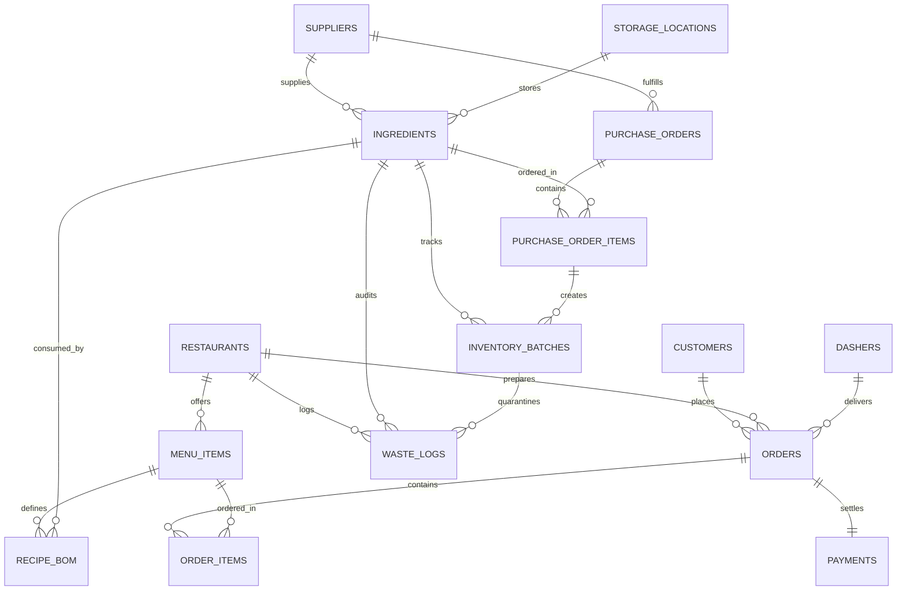

# 🚀 DoorDash: Online Food Delivery & Restaurant Supply-Chain DBMS

> **Jaypee Institute of Information Technology (JIIT), Noida**  
> **Department of Computer Science & Engineering and Information Technology**  
> **Course:** Database Management Systems Lab (PBL) — 3rd Semester  
> **Student / Lead Architect:** Divyansh Agarwal (Enrolment No: `2501030124`)  
> **Team Batch:** B2  
> **Database Engine:** PostgreSQL 17 with PostGIS 3.6 Spatial Extension  
> **Front-End Architecture:** 100% Pure HTML5 & CSS3 (Zero JavaScript)

---

## 🌟 Executive Summary & Real-World Problem

In multi-sided hyper-local food delivery networks (such as DoorDash, UberEats, and Zomato), database architectures face three major challenges:
1. **The Phantom Inventory Problem:** Concurrent orders competing for the same raw food ingredients result in overselling, kitchen cancellations, and deadlocks.
2. **The Geodesic Spatial Dispatch Challenge:** Matching nearby drivers within minutes requires calculating real-world spherical distances on Earth without bogging down the database with table scans.
3. **Food Waste & Spoilage Write-Offs:** Storing perishable inventory without automated expiry tracking results in spoiled ingredients being cooked or unaccounted financial loss.

This project delivers an enterprise-grade relational database and single-restaurant flagship web application that solves all three challenges using **PostgreSQL 17**, **PostGIS 3.6**, **ACID Two-Phase Locking (2PL)**, and **automated trigger-based quarantine**.

---

## 🏗️ Relational Architecture (3NF Schema)

The database schema is normalized strictly to **Third Normal Form (3NF)** across **16 tables**, grouped into 5 decoupled stages:



### Key Schema Entities:
* **Procurement:** `suppliers`, `purchase_orders`, `purchase_order_items`, `storage_locations`
* **Inventory & Bill of Materials:** `ingredients`, `inventory_batches`, `recipe_bom`, `waste_logs`
* **Consumer Ordering & Commerce:** `restaurants`, `menu_items`, `customers`, `orders`, `order_items`, `payments`
* **Spatial Courier Logistics:** `dashers` (courier locations tracked via PostGIS `GEOMETRY(Point, 4326)`)

---

## ⚡ Core Engineering Deliverables

### 1. Two-Phase Locking (2PL) Concurrency Engine (`place_order_atomic`)
A high-throughput PL/pgSQL transaction procedure that encapsulates order placement, recipe deduction, spatial matching, and multi-split ledger settlement inside an atomic boundary:
* **2PL Growing Phase:** Exclusively row-locks active batches using `PERFORM ... FROM inventory_batches ... FOR UPDATE`.
* **FIFO Multi-Batch Depletion:** Drains earliest-expiring food batches first before touching newer stock.
* **Spatial Courier Match:** Executes a sub-50ms geodesic bounding-box query:
  ```sql
  SELECT dasher_id FROM dashers
  WHERE is_active = TRUE AND is_available = TRUE
    AND ST_DWithin(current_location::geography, v_rest_location, 5000)
  ORDER BY ST_Distance(current_location::geography, v_rest_location) ASC
  LIMIT 1 FOR UPDATE;
  ```
* **Multi-Split Financial Settlement:** Reconciles the 3-way ledger ($80\%$ restaurant, $20\%$ platform fee, and dasher delivery fee + tip) with zero-penny discrepancy enforced by check constraints.

### 2. Divyansh Agarwal's Synopsis Deliverable: Automated Expiry Triggers
* **`trg_inventory_expiry_audit` Trigger:** A `BEFORE UPDATE` trigger attached to `inventory_batches`.
* **Instant Quarantine:** If any batch passes its shelf life, the trigger automatically clamps `current_stock_qty = 0.00` and flips `is_expired = TRUE`.
* **Immutable Audit Trail:** Automatically calculates total financial write-off (`wasted_qty * unit_cost`) and writes permanent audit rows to `waste_logs`.
* **Daily Maintenance Sweep Routine:** Callable via `SELECT * FROM sweep_and_quarantine_expired_batches();`.

---

## 📱 Pure HTML/CSS Mobile Front-End (`doordash_restaurant_app.html`)

A single-restaurant responsive web application built **strictly in 100% pure HTML5 and CSS3** (zero JavaScript):
* **State Management:** Navigation and routing powered entirely via hidden radio buttons and CSS `:checked ~ .app-container` selectors.
* **Reactive Stepper:** Interactive `+` and `−` quantity counters ($1$ to $5$) that recalculate order button prices dynamically.
* **Decoupled Dish Flow:** Distinct screens for *Cheesy Street Fries* (₹180) and *Smoked Brioche Burger* (₹350) with their respective Recipe BOM ingredients.
* **Live PostGIS Tracker:** Modern light-theme cartographic map showing DoorDash Kitchen #1, customer destination at JIIT Noida, and pulsing courier pin Raju Kumar (at 171m).
* **Local Identity:** Features the official DoorDash winged logo and high-resolution photo of the **JIIT Annapurna Cafeteria**.

---

## 📂 Repository File Index

```
.
├── doordash_full_schema.sql           # Complete PostgreSQL 17 + PostGIS DDL, indexes, 2PL procedure, and triggers
├── doordash_seed_data.sql             # Realistic JIIT Noida Sector 62 seed dataset (FIFO batches, expired test batch)
├── doordash_viva_queries.sql          # 5 benchmark evaluation queries for viva demonstration
├── doordash_restaurant_app.html       # Single-restaurant responsive mobile frontend (100% Pure HTML/CSS)
├── DoorDash_DBMS_Engineering_Guide.html # Comprehensive academic engineering handbook & viva guide
├── doordash_logo.png                  # Official DoorDash winged brand logo
├── doordash_logo_transparent.png      # Transparent PNG for light header navigation
├── doordash_logo_white.png            # Solid white silhouette for crimson splash screen
├── jiit_cafeteria.jpg                 # JIIT Annapurna Cafeteria portrait photograph
└── README.md                          # Project master documentation
```

---

## 🚀 Quick Start Guide

### Step 1: Initialize Database & PostGIS
In pgAdmin 4 or `psql`:
```sql
CREATE DATABASE doordash_db;
\c doordash_db
\i 'doordash_full_schema.sql'
```

### Step 2: Seed Realistic Noida Data
```sql
\i 'doordash_seed_data.sql'
```

### Step 3: Run Live ACID Order Placement
```sql
SELECT jsonb_pretty(place_order_atomic(
    p_customer_id   => 1,
    p_restaurant_id => 1,
    p_item_id       => 1,      -- Cheesy Street Fries (₹180)
    p_quantity      => 2,      -- 2 orders (₹360 food + ₹40 delivery fee + ₹30 tip = ₹430 total)
    p_payment_method=> 'UPI'
));
```

### Step 4: Run Automated Expiry Sweep Routine
```sql
SELECT * FROM sweep_and_quarantine_expired_batches();
SELECT * FROM waste_logs;
```

### Step 5: Execute 5 Benchmark Viva Queries
Open **`doordash_viva_queries.sql`** in pgAdmin 4 and execute (`F5`) to view PostGIS distance metrics, FIFO health countdowns, financial reconciliations, and BOM profit margins.

---

## 🎓 Academic Credit & Attribution
* **Course:** Database Management Systems Lab (PBL) — 3rd Semester
* **Institute:** Jaypee Institute of Information Technology (JIIT), A-10, Sector 62, Noida, Uttar Pradesh 201309
* **Department:** Computer Science & Engineering and Information Technology
* **Lead Developer:** Divyansh Agarwal (Enrolment No: 2501030124, Batch B2)
